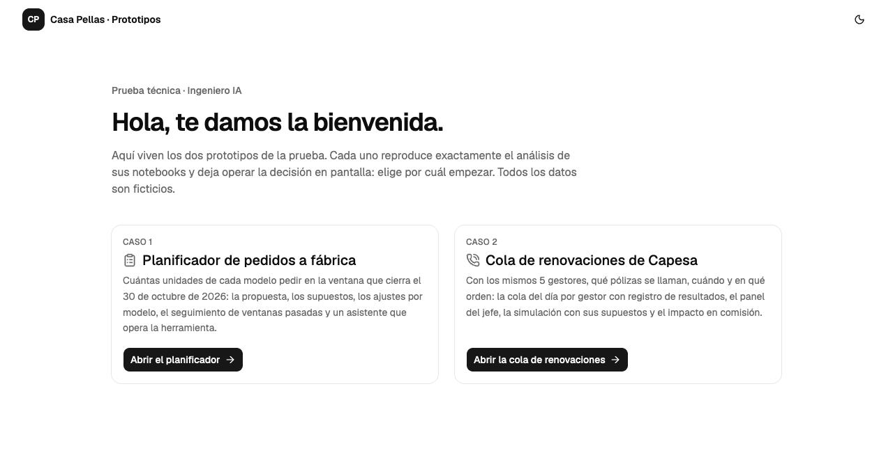
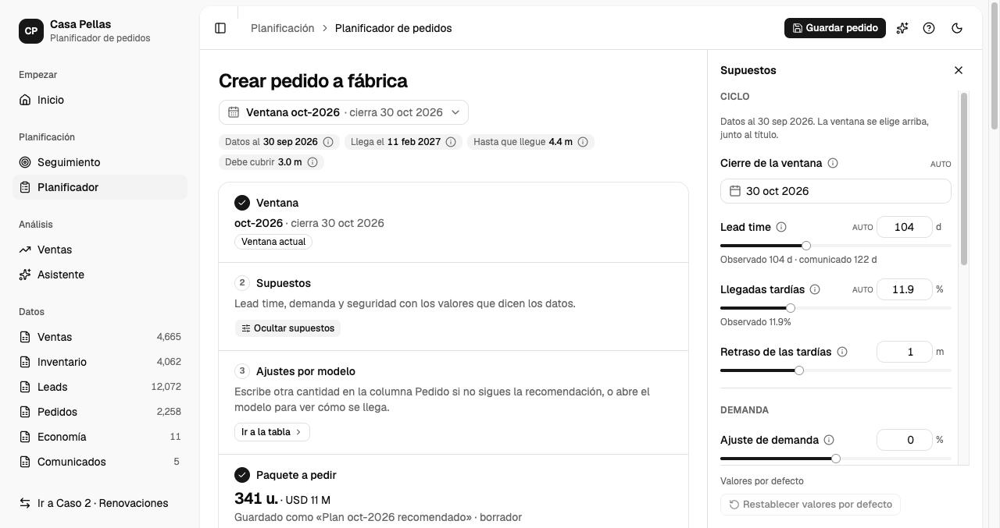
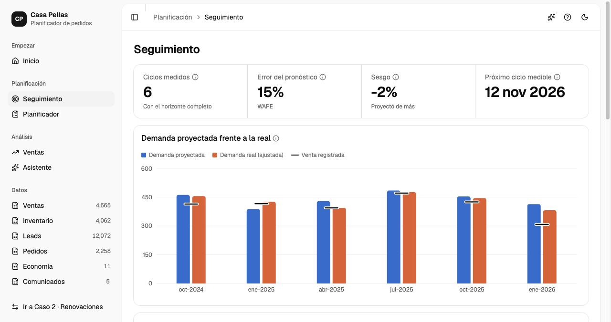
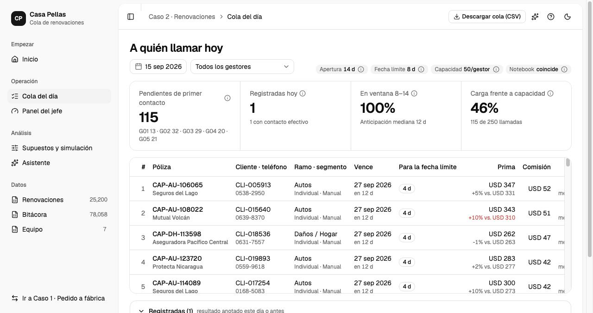
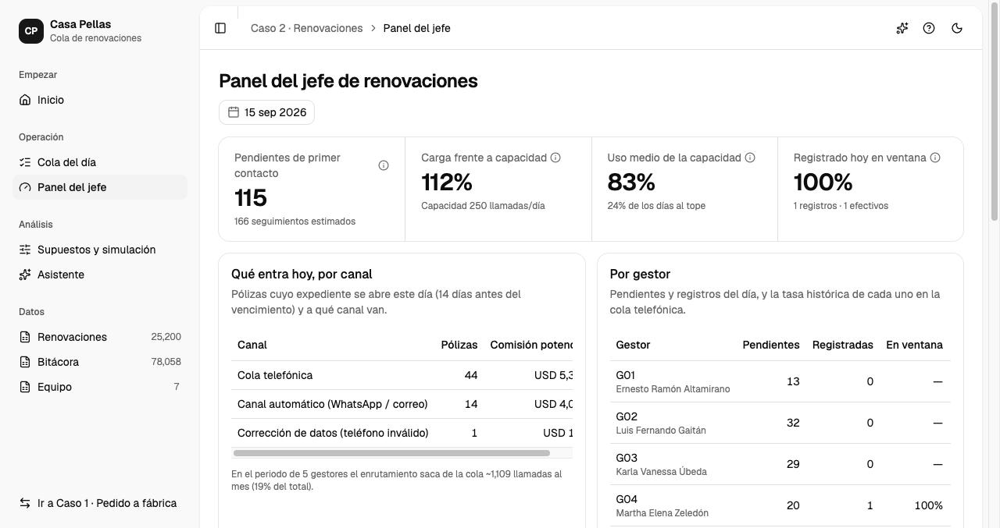
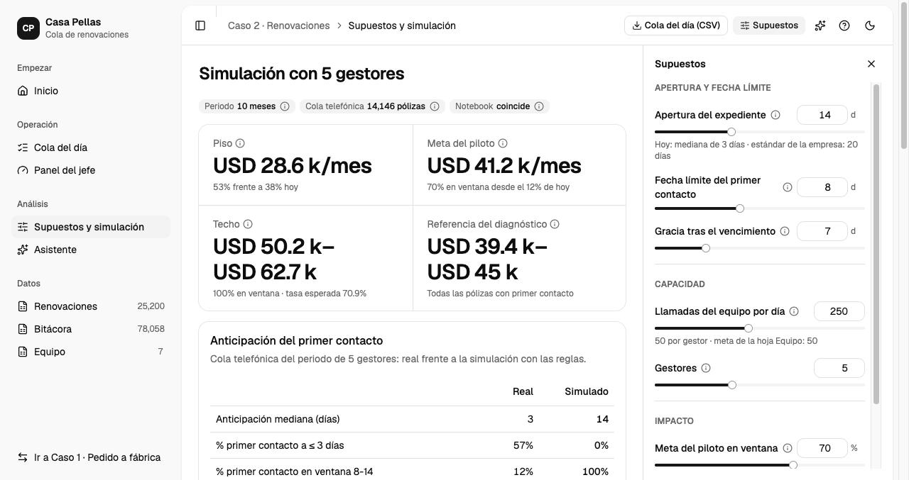
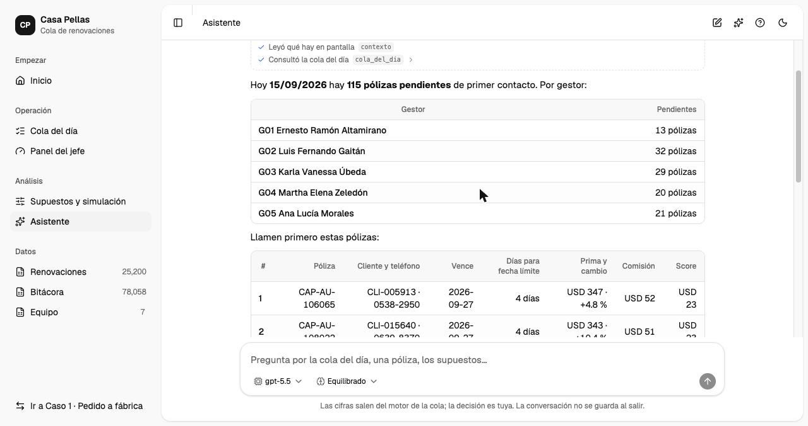

# Prueba Técnica Ingeniero IA

Dos casos resueltos con notebooks reproducibles y una app web que los reproduce exactamente. Todos los datos
son ficticios.

**App publicada:** https://prueba-tecnica-casa-pellas.fastapicloud.dev

| Caso | Pregunta | Notebooks | Prototipo en la app |
|---|---|---|---|
| 1 · Pedido a fábrica | ¿Cuántas unidades de cada modelo pedir en la ventana que cierra el 30-oct-2026? | `notebooks/caso1/` | Planificador de pedidos (`#/caso1`) |
| 2 · Renovaciones | ¿Cómo optimizar el proceso de renovaciones con 5 gestores? | `notebooks/caso2/` | Cola de renovaciones (`#/caso2`) |

Los supuestos (`S1.x`, `S2.x`) se explican en la celda del notebook donde se aplican. Las respuestas a la
gerencia y al Comité están en el documento de la prueba y en la última sección de cada notebook `02`.

## La app



**Caso 1 · Planificador de pedidos.** Con el Excel del repo y los valores por defecto da el mismo pedido que el
notebook (341 unidades, USD 10,951,670) y exporta los mismos CSV. El planificador deja mover cada supuesto (lead
time, llegadas tardías, demanda en meses sin stock, corrección aprendida, sustitución, stock de seguridad),
ajustar cada modelo y ver cómo se llega a su cifra; «Guardar plan» registra el pedido decidido. *Seguimiento*
compara, ventana por ventana, lo que habría proyectado la herramienta con lo que pasó y propone una corrección
por modelo. *Ventas* y *Datos* muestran las ventas y cada hoja del Excel ya limpia.





**Caso 2 · Cola de renovaciones.** Produce la misma cola del 15-sep-2026 que el notebook (116 pólizas) y el
mismo rango de impacto (piso USD 28.6 k, meta 41.2 k y techo 50.2–62.7 k al mes). La *Cola del día* es lo que
vería cada gestor por la mañana, ordenada por fecha límite y por comisión × mejora esperada, con el registro del
resultado de cada llamada. El *Panel del jefe* muestra qué entra por canal, carga frente a capacidad, gestores e
indicadores del piloto. *Supuestos y simulación* recalcula la simulación al mover apertura, fecha límite,
capacidad o meta del piloto.







**Asistente.** Cada caso tiene un agente (LangChain `create_agent`) en una pantalla de chat y en un panel
lateral. No calcula nada: sus herramientas llaman al mismo motor determinista que la pantalla y el modelo
resume. Responde la pregunta de cada caso en lenguaje natural, simula escenarios, cambia los supuestos en
pantalla, explica un modelo o una póliza, consulta las hojas de datos, grafica y exporta. Las acciones con
efecto (guardar un plan, registrar el resultado de una llamada) se detienen y piden aprobación en el chat
(*human in the loop*). Funciona con OpenAI o Anthropic según la clave configurada; sin clave, el chat lo indica
y el resto de la app funciona igual. La conversación no se guarda.



Cada prototipo tiene un recorrido guiado desde *Inicio* (icono «?» en cualquier pantalla). Son prototipos: la
fuente de cada caso es su Excel, el mismo del análisis; en producción la alimentarían procesos de ETL. Los
planes guardados y los resultados registrados son archivos JSON, que en FastAPI Cloud se pierden en cada
redespliegue; en producción irían a una base de datos.

## Estructura

```
data/raw/            caso1_vehiculos_nuevos.xlsx, caso2_renovaciones.xlsx  (Excel originales)
data/processed/      caso{1,2}_limpio.pkl, escritos por 00_limpieza (no se versionan)
notebooks/caso1/     00_limpieza → 01_eda → 02_pedido_fabrica
notebooks/caso2/     00_limpieza → 01_eda_diagnostico → 02_prototipo_priorizacion
outputs/             CSV y figuras que producen los notebooks 02
app/                 API FastAPI: routers/, schemas/ y los motores en services/{factory_order,renewals,agent}/
frontend/            React + Vite + TypeScript + shadcn/ui + Recharts; su build (frontend/dist/) lo sirve la API
tests/               pytest: los motores reproducen los CSV de los notebooks; API y asistentes con modelo falso
docs/capturas/       capturas de pantalla de la app
```

**Notebooks.** `00_limpieza` lee el Excel, lo valida (se detiene con `assert` si aparece algo que no reconoce),
lo concilia entre hojas y escribe la base limpia. `01` es el diagnóstico (demanda, inventario, lead time y
economía en el Caso 1; anticipación del contacto, capacidad, contactabilidad y costo del problema en el Caso 2).
`02` es el sistema: el cálculo del pedido con su sensibilidad y mezcla por versión, o el enrutamiento, la
prioridad, la simulación con 5 gestores y el diseño del piloto; termina con las gráficas y la respuesta.

**Método.** Los pasos siguen el ciclo de vida del análisis de datos: evaluación del caso e identificación de
datos (`00` §1–§2), adquisición, extracción, validación y limpieza (`00` §4), agregación (`00` §5), análisis y
visualización (`01` y `02`) y uso de los resultados (`02`, últimas secciones). Las etapas de adquisición,
filtrado y extracción se resuelven en una sola pasada porque cada caso llega en un único Excel.

## Cómo reproducirlo

Requisitos: Python 3.12+ y [uv](https://docs.astral.sh/uv/). Los notebooks se ejecutan desde su carpeta y en
orden, porque `00_limpieza` escribe la base que leen los otros dos:

```bash
uv sync --all-groups
cd notebooks/caso1 && uv run jupyter nbconvert --to notebook --execute --inplace 00_limpieza.ipynb 01_eda.ipynb 02_pedido_fabrica.ipynb
cd ../caso2    && uv run jupyter nbconvert --to notebook --execute --inplace 00_limpieza.ipynb 01_eda_diagnostico.ipynb 02_prototipo_priorizacion.ipynb
```

Los notebooks guardan sus salidas, así que se pueden leer sin ejecutarlos. Para el siguiente ciclo basta con
reemplazar el Excel y revisar `PARAMS` en `00_limpieza` (fechas de corte y ventana en el Caso 1; dotación en el
Caso 2); la app hace lo mismo con la fuente al día, sin tocar los notebooks.

## Correr la app en local

Requisitos adicionales: Node.js 20.19+.

```bash
uv sync && (cd frontend && npm install)
cp .env.example .env             # opcional: todo tiene default; aquí va la clave del asistente (OPENAI_API_KEY o ANTHROPIC_API_KEY)
uv run fastapi dev               # API en http://localhost:8000
cd frontend && npm run dev       # frontend en http://localhost:5173, reenvía /api a la API
```

La API está documentada en `/api/docs`. Lo esencial: `POST /api/factory-order/calculate` y
`POST /api/renewals/simulate` corren los motores con los supuestos del cuerpo (`{}` = los del notebook),
`POST /api/renewals/queue?day=` arma la cola del día, `GET /api/data/sheets/{hoja}` y
`GET /api/renewals/data/sheets/{hoja}` devuelven las hojas limpias, y `POST /api/agent/chat` es el asistente en
streaming. Para agregar un endpoint: esquema en `app/schemas/`, lógica en `app/services/`, ruta en
`app/routers/`.

## Build y deploy

FastAPI Cloud no compila el frontend, así que el build va antes de cada deploy:

```bash
cd frontend && npm run build && cd ..   # genera frontend/dist/
uv run fastapi deploy                   # la primera vez pide iniciar sesión
```

`.fastapicloudignore` deja fuera notebooks, tests y datos salvo los dos Excel y los CSV que lee la API. La clave
del asistente se configura como variable de entorno de la app en FastAPI Cloud (`fastapi cloud env set`), nunca
en el código.

## Calidad

```bash
uv run pytest                    # los motores reproducen los CSV de los notebooks; API, asistentes y validaciones
uv run ruff check notebooks app tests && uv run ruff format --check notebooks app tests
cd frontend && npm run lint && npm run build
```

## Uso de IA y cómo se validó

Usé Claude Code para escribir y refactorizar código a partir de la lógica que yo definía, revisar la redacción
y hacer una revisión final contra el enunciado. El método, los supuestos y las decisiones de análisis son míos
y están documentados en la celda donde se aplican. Nada se aceptó sin comprobarlo:

- Los notebooks `00_limpieza` detienen la ejecución si un valor queda fuera de catálogo; el inventario cuadra
  contra facturas y recepciones y la bitácora de llamadas contra la hoja de renovaciones, sin diferencias.
- Cada cifra del texto se contrasta con la tabla que la genera; el pedido se recalcula en escenarios
  alternativos y el impacto del Caso 2 se reporta como rango, validado con un periodo distinto del que se usó
  para estimarlo.
- Todo se vuelve a ejecutar desde los Excel originales, y los tests comprueban que los motores de la app
  producen la misma base limpia, los mismos CSV y los mismos números que los notebooks.
